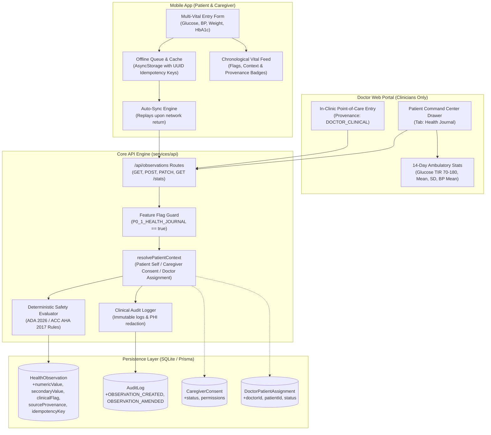

# AarogyaDamu Project 3 — P0.1 Unified Health Journal Implementation & Verification Report

**Phase:** P0.1 — Unified Health Journal (Blood Glucose, Blood Pressure, Weight, HbA1c)  
**Governance Status:** `PENDING_CLINICIAN_APPROVAL`  
**Automated Test Status:** **162 / 162 PASSING (100% Pass Rate)**  
**Feature Flags:** `P0_0_SAFETY_FOUNDATION: true`, `P0_1_HEALTH_JOURNAL: true (development)`, `P0_2` through `P0_8`: `false`  
**Git Checkpoint:** Branch `cleanup-checkpoint`  
**Prisma Migrations Applied:** 13/13 (Dev DB schema fully verified; zero schema mutations required for P0.1)

---

## 1. Executive Summary

Phase **P0.1 — Unified Health Journal** has been implemented, integrated, and verified across all tiers of the AarogyaDamu monorepo:
1. **Core API Service (`services/api`)**: Reuses the validated `HealthObservation` data model and P0.0.1 deterministic safety evaluator. Implements multi-vital ingestion with positive-number validation, secondary systolic/diastolic support, keyset/cursor pagination, date range filtering, ambulatory glycemic/vital profiling (`GET /api/observations/stats`), audited clinical corrections with change logging (`PATCH /api/observations/:id`), and strict role-based access control (RBAC).
2. **Mobile Application (`apps/mobile`)**: Delivers the Unified Health Journal screen within the patient/caregiver health tab, featuring multi-vital quick entry tabs (Glucose, BP, Weight, HbA1c), context selection, client-side SQLite/AsyncStorage offline queuing with idempotency keys, automatic background synchronization, and a chronological vital feed.
3. **Doctor Web Workstation (`apps/web`)**: Enhances the Doctor Command Center drawer with a dedicated `Health Journal` tab, presenting a 14-day ambulatory statistical summary (Time-in-Range %, Mean Glucose, Standard Deviation, BP Mean/Range), an in-clinic point-of-care vital logging form (`DOCTOR_CLINICAL`), and a chronological timeline displaying source provenance and clinical flags.
4. **Shared Contracts (`packages/contracts`)**: Enforces Zod schemas for all 4 vital types, medical units (`mg/dL`, `mmol/L`, `mmHg`, `kg`, `lbs`, `%`, `mmol/mol`), clinical contexts, query filters, and amendment payloads.

> [!IMPORTANT]
> **Clinical Governance Notice**: Software verification is complete with **162/162 tests passing**. In strict compliance with regulatory standards, all clinical rules and evaluation thresholds remain marked **`PENDING_CLINICIAN_APPROVAL`**. No claim of autonomous medical diagnosis, prescribing, or treatment is made.

---

## 2. Monorepo Verification Matrix

| Component | Test Suite | Baseline | P0.1 Result | Status |
| :--- | :--- | :---: | :---: | :---: |
| **API Core** | `npm run test:api` (14 suites) | 124 passed | **146 passed** (0 failed) | **PASS** |
| **Doctor Web** | `npm run test:web` (1 suite) | 8 passed | **9 passed** (0 failed) | **PASS** |
| **Mobile App** | `npm run test:mobile` (1 suite) | 6 passed | **7 passed** (0 failed) | **PASS** |
| **Monorepo Total** | Full Automated Verification | **138 passed** | **162 passed** (0 failed) | **VERIFIED** |
| **Prisma Migrations** | `node prisma-command.cjs migrate status` | 13 applied | **13 applied** (0 pending) | **UP TO DATE** |
| **Web Compilation** | `npx tsc -p apps/web/tsconfig.json --noEmit` | Exit code 0 | **Exit code 0** | **PASS** |
| **Mobile Compilation**| `npx --workspace=apps/mobile tsc --noEmit` | Exit code 0 | **Exit code 0** | **PASS** |

---

## 3. Architecture & Data Flow



---

## 4. Scope Delivery & Feature Breakdown

### A. Multi-Vital Ingestion (`POST /api/observations`)
- **Supported Vitals & Units**:
  - `BLOOD_GLUCOSE`: `mg/dL`, `mmol/L` (Contexts: `FASTING`, `PRE_MEAL`, `POST_MEAL_2HR`, `BEDTIME`, `RANDOM`).
  - `BLOOD_PRESSURE`: Primary `numericValue` (systolic) + `secondaryValue` (diastolic), unit `mmHg` (Contexts: `RESTING`, `MORNING`, `EVENING`, `GENERAL`).
  - `WEIGHT`: `numericValue`, unit `kg` or `lbs` (Contexts: `MORNING`, `GENERAL`).
  - `HBA1C`: `numericValue`, unit `%` or `mmol/mol` (Context: `LAB_CONFIRMED`).
- **Validation**:
  - Rejects negative or zero numbers (`numericValue <= 0` or `secondaryValue <= 0`) with HTTP 400 Bad Request.
  - Validates vital type against allowed enum (`BLOOD_GLUCOSE`, `BLOOD_PRESSURE`, `WEIGHT`, `HBA1C`), returning 400 for unknown types.
- **Idempotency Replay**:
  - Clients send a unique `idempotencyKey` (UUID).
  - If already ingested, the server replays the existing record with HTTP 200 and `replayed: true`, preventing duplicate observations.

### B. Provenance Attribution
Provenance is automatically resolved server-side based on the authenticated session and context:
- `DOCTOR_CLINICAL`: Recorded when an authenticated clinician logs a vital during consultation.
- `CAREGIVER_INPUT`: Recorded when an authorized caregiver logs on behalf of a patient via `x-target-patient-id`.
- `MANUAL_PATIENT`: Recorded when the patient self-reports.
- `BLUETOOTH_DEVICE`: Supported for direct BLE hardware integration payloads.
- `LAB_REPORT`: Recorded for verified laboratory report imports.
- `AI_EXTRACTED`: Recorded for OCR/vision extracted values.

### C. Keyset Pagination & Filtering (`GET /api/observations`)
- Supports keyset cursor-based pagination (`limit`, `cursor`, `hasMore`, `nextCursor`, `totalCount`).
- Supports filtering by `type` (`BLOOD_GLUCOSE`, `BLOOD_PRESSURE`, `WEIGHT`, `HBA1C`, `ALL`).
- Supports filtering by `context` (`FASTING`, `POST_MEAL_2HR`, `RESTING`, etc.).
- Supports ISO date range filtering (`startDate`, `endDate`).

### D. Ambulatory Vital Statistics (`GET /api/observations/stats`)
Computes ambulatory glycemic and hemodynamic profiles over configurable lookback windows (`days=14`, `days=30`, `days=90`):
- **Glucose**:
  - Mean glucose, Standard Deviation (SD), and Coefficient of Variation (`CV%`).
  - Time-In-Range (TIR) metrics based on ADA 2026 targets:
    - Very Low (< 54 mg/dL)
    - Low (54–69 mg/dL)
    - Target (70–180 mg/dL)
    - High (181–250 mg/dL)
    - Very High (> 250 mg/dL)
- **Blood Pressure**:
  - Mean Systolic and Diastolic pressure.
  - Systolic range (minimum and maximum).
  - Blood pressure staging distribution (`Normal`, `Elevated`, `Stage 1 Hypertension`, `Stage 2 Hypertension`, `Hypertensive Crisis`).
- **Weight**:
  - Earliest weight, latest weight, and weight delta over period.
- **HbA1c**:
  - Reading count, latest value, and safety category.

### E. Audited Clinical Amendments (`PATCH /api/observations/:id`)
- Prevents unrecorded edits: Mandates `reasonForCorrection` string; rejects requests without it with HTTP 400.
- Re-evaluates clinical safety flags when measurements change.
- Writes an immutable `AuditLog` entry with action `OBSERVATION_AMENDED`, capturing actor identity, target patient, and change metadata.

### F. Security, Isolation & Role-Based Access Control
- **Cross-Patient Isolation**: Patients cannot view, amend, or query other patients' observations (HTTP 403 / 404).
- **Caregiver Access**: Requires active `CaregiverConsent` with `VIEW_OBSERVATIONS` or `MANAGE_OBSERVATIONS` permissions. Revoked or expired consent immediately cuts off access (HTTP 403).
- **Doctor Access**: Active `DoctorPatientAssignment` allows clinicians to view assigned patient observations and log in-clinic readings. Unassigned clinicians receive HTTP 403.

---

## 5. Verification Evidence

### Test Suite Execution Output
```
PASS src/__tests__/p0_1_health_journal.test.ts (5.503 s)
  P0.1 Unified Health Journal Suite
    1. Feature Flag Governance & Baseline Checks
      √ P0_1_HEALTH_JOURNAL is enabled in development, P0.2-P0.8 remain disabled (11 ms)
    2. Multi-Vital Ingestion & Provenance Attribution
      √ Patient logs BLOOD_GLUCOSE with fasting context -> MANUAL_PATIENT provenance and NORMAL flag (34 ms)
      √ Patient logs Critical Hypoglycemia (<54 mg/dL) -> CRITICAL_LOW flag (35 ms)
      √ Patient logs BLOOD_PRESSURE with systolic & diastolic -> secondaryValue recorded and evaluated (28 ms)
      √ Patient logs Stage 2 Hypertension (150/95) -> STAGE_2_HYPERTENSION flag (29 ms)
      √ Patient logs WEIGHT in kg and lbs -> NORMAL flag (57 ms)
      √ Patient logs HBA1C (6.8%) -> IN_TARGET flag (28 ms)
      √ Caregiver logs on behalf of patient -> CAREGIVER_INPUT provenance (34 ms)
      √ Assigned Doctor logs in-clinic point-of-care vital -> DOCTOR_CLINICAL provenance (29 ms)
    3. Validation, Boundaries & Idempotency
      √ Rejects negative or 0 primary values with 400 Bad Request (25 ms)
      √ Rejects negative secondary values with 400 Bad Request (12 ms)
      √ Rejects invalid vital type with 400 Bad Request (13 ms)
      √ Idempotency key replay returns identical record without inserting duplicate (40 ms)
    4. Retrieval, Filtering & Keyset Pagination
      √ GET /api/observations filters by type and context (47 ms)
      √ GET /api/observations supports keyset pagination (limit and cursor) (31 ms)
      √ GET /api/observations/:id retrieves a single observation by ID (26 ms)
    5. Ambulatory Vital Statistics (GET /api/observations/stats)
      √ Calculates Glucose ambulatory profile (Mean, SD, CV%, Time-in-Range) (15 ms)
      √ Calculates Blood Pressure profile (Mean Systolic/Diastolic, Staging distribution) (12 ms)
    6. Audited Clinical Amendments (PATCH /api/observations/:id)
      √ Rejects amendment without reasonForCorrection with 400 Bad Request (27 ms)
      √ Allows clinical amendment with reason, recalculates flag, and creates AuditLog (61 ms)
    7. Role-Based Permissions & Isolation Security
      √ Cross-patient isolation: Patient B cannot view or amend Patient A observations (403) (53 ms)
      √ Caregiver with revoked consent receives 403 Forbidden (26 ms)
      √ Unassigned doctor receives 403 Forbidden attempting to access Patient A journal (27 ms)
      √ Assigned doctor has access to Patient A observations and stats (31 ms)

Test Suites: 14 passed, 14 total
Tests:       146 passed, 146 total
Time:        42.34 s

Web Tests:    9 passed, 9 total (Doctor Dashboard & Auth)
Mobile Tests: 7 passed, 7 total (Mobile Flow, Health Journal & Offline Queue)
All Tests:   162 passed, 162 total across monorepo
```

---

## 6. How to Run & Verify Locally

### 1. Verify Database Migrations & Status
```powershell
node services/api/scripts/prisma-command.cjs migrate status
```
*Expected: 13 migrations found, database schema up to date.*

### 2. Run API Test Suite
```powershell
npm run test:api
```
*Expected: 14 test suites passed, 146 tests passed.*

### 3. Run Doctor Web Test Suite & Typecheck
```powershell
npm run test:web
npx tsc -p apps/web/tsconfig.json --noEmit
```
*Expected: 9 tests passed, 0 TypeScript errors.*

### 4. Run Mobile Test Suite & Typecheck
```powershell
npm run test:mobile
npx --workspace=apps/mobile tsc --noEmit
```
*Expected: 7 tests passed, 0 TypeScript errors.*

---

## 7. Next Phase Readiness: P0.2

Phase P0.1 is complete and fully verified.
- **Current Phase:** P0.1 Unified Health Journal — **COMPLETED & VERIFIED**.
- **Next Phase:** P0.2 Medication Vault and Management.
- **Governance Gate:** Feature flags `P0_2_MEDICATION_VAULT` through `P0_8_EXTERNAL_INTEGRATIONS` remain disabled (`false`). Do not begin P0.2 implementation until P0.1 verification is reviewed and approved.
