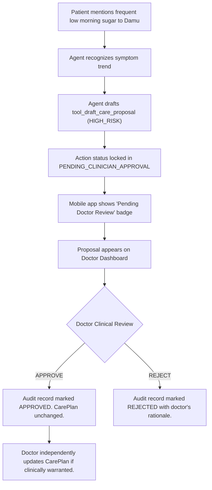

# AarogyaDamu Project 3 — Clinician Demonstration Guide
**Controlled Demonstration of Governed Diabetes Care Companion with Synthetic Patient Data**

**Audience:** Licensed Medical Practitioners (Endocrinologists, Diabetologists, General Physicians)  
**Version:** P0.7.8 (Demonstration Preparation)  
**Safety Classification:** NON-PRODUCTION SYNTHETIC DEMONSTRATION  
**Clinical Protocol:** STRICT HUMAN-IN-THE-LOOP CLINICAL GOVERNANCE  
**Date:** 2026-11-03  

---

## 1. Product Overview for Clinicians

### 1.1 What is AarogyaDamu?
**AarogyaDamu** is a clinically governed, bilingual diabetes companion platform developed for Indian healthcare contexts. It bridges patients, authorized family caregivers, and attending physicians into a single coordinated care circle.

```
┌────────────────────────────────────────────────────────────────────────┐
│                        AAROGYADAMU CARE CIRCLE                         │
├───────────────────────┬────────────────────────┬───────────────────────┤
│   PATIENT & CAREGIVER │   DAMU GOVERNED AGENT  │   ATTENDING DOCTOR    │
│   (Mobile App)        │   (Runtime Safety Bus) │   (Web Workstation)   │
├───────────────────────┼────────────────────────┼───────────────────────┤
│ • Glucose Logging     │ • Bounded Actions      │ • Longitudinal Trends │
│ • Medication Vault    │ • Risk-Tier Defense    │ • Adherence Monitoring│
│ • Care Plan Tasks     │ • Emergency Precedence │ • AI Proposal Review  │
│ • Multilingual Voice  │ • Audit Provenance     │ • Scribe Transcription│
└───────────────────────┴────────────────────────┴───────────────────────┘
```

### 1.2 The Core Clinical Safety Promise
> [!IMPORTANT]
> **AarogyaDamu does NOT independently diagnose illness, prescribe medication, or alter therapy.**  
> - **Physicians retain 100% prescriptive authority:** The AI cannot modify insulin units, titrate oral hypoglycemic agents, or change care plan targets autonomously.
> - **Advisory Only:** When the AI identifies glycemic trends or missed tasks, it drafts **advisory care proposals** that are routed exclusively to the doctor for review.
> - **Two-Product Separation:** Patients and caregivers interact through the mobile app; licensed clinicians manage patients through the secure web workstation.

---

## 2. Patient Mobile App Walkthrough

The mobile application is designed for low digital-literacy patients and family caregivers, supporting English, Marathi, Hindi, and Telugu.

```
┌────────────────────────────────────────────────────────┐
│                   MOBILE DASHBOARD                     │
├────────────────────────────────────────────────────────┤
│ 👤 Ramesh Deshmukh (Type 2 Diabetes)                   │
│ 🎯 Target: Fasting 80–130 mg/dL | Post-Meal <180 mg/dL │
├────────────────────────────────────────────────────────┤
│ 📊 TODAY'S GLYCHEMIC STATUS:                           │
│    • Fasting: 118 mg/dL  [In Target]                   │
│    • Post-Meal: 162 mg/dL [In Target]                  │
├────────────────────────────────────────────────────────┤
│ 💊 TODAY'S MEDICATIONS:                                │
│    • Tab Metformin 500mg SR (Night with dinner) [DONE] │
│    • Tab Telmisartan 40mg (Morning)             [DONE] │
├────────────────────────────────────────────────────────┤
│ 📋 TODAY'S TASKS:                                      │
│    • Morning Fasting Glucose Check              [DONE] │
│    • 30-Minute Evening Post-Dinner Walk      [PENDING] │
└────────────────────────────────────────────────────────┘
```

### 2.1 Diabetes Health Journal
- **Discrete & CGM Observations:** Patients log blood glucose values tagged with physiological context (`FASTING`, `POST_MEAL_2HR`, `BEDTIME`, `RANDOM`).
- **Clinical Threshold Flags:** Readings are evaluated against American Diabetes Association (ADA) and ICMR clinical boundaries:
  - `< 54 mg/dL`: Severe Hypoglycemia (Triggers Immediate Safety Alert)
  - `54–69 mg/dL`: Alert Hypoglycemia
  - `70–130 mg/dL`: Target Fasting / Pre-Meal Range
  - `131–180 mg/dL`: Target Post-Meal Threshold
  - `> 250 mg/dL`: Hyperglycemia Flag

### 2.2 Medication Vault & Adherence
- Displays physician-prescribed medications with dosage, timing, and meal instructions.
- Tracks daily adherence (`TAKEN`, `SKIPPED`, `MISSED`) with audit provenance (whether logged by patient, caregiver, or doctor).
- Distinguishes **Clinician-Reviewed** medications from unverified self-reported supplements.

### 2.3 Lifestyle Tracking & Digital Health Twin
- Tracks physical activity (step counts, walking minutes), carbohydrate consumption, hydration, and sleep.
- Displays a read-only **Digital Health Twin** that models glycemic trajectory without presenting speculative or misleading clinical claims.

### 2.4 Emergency SOS & Precedence
- Deliberate 3-second hold to activate, preventing accidental triggers.
- Alerts designated emergency contacts and family caregivers.
- **Safety Disclaimer:** Prominently advises the patient that the app is NOT a replacement for emergency ambulance services and provides one-touch dialing to **112** and **108**.

---

## 3. Doctor Web Dashboard Walkthrough

The Doctor Workstation provides licensed clinicians with comprehensive longitudinal oversight of assigned patients.

```
┌──────────────────────────────────────────────────────────────────────────────────────────────┐
│ AAROGYADAMU DOCTOR WORKSTATION — DR. ANJALI KULKARNI (ENDOCRINOLOGIST)                       │
├────────────────────────────┬─────────────────────────────────────────────────────────────────┤
│ PATIENT ROSTER             │ LONGITUDINAL PATIENT COMMAND CENTER                             │
├────────────────────────────┼─────────────────────────────────────────────────────────────────┤
│ • Ramesh Deshmukh (Stable) │ Patient: Sunita Sharma (Female, 65y) — Type 2 Diabetes          │
│ • Suresh Patel (Spikes)    ├─────────────────────────────────────────────────────────────────┤
│ • Sunita Sharma (Proposal) │ [Longitudinal Glycemic Graph: 7-Day Fasting Average 74 mg/dL]  │
│                            ├─────────────────────────────────────────────────────────────────┤
│                            │ ACTIVE AI CARE PROPOSALS (1 Awaiting Review):                   │
│                            │ ┌─────────────────────────────────────────────────────────────┐ │
│                            │ │ ⚠️ Review Target Fasting Glucose Range                      │ │
│                            │ │ Rationale: 7-day fasting avg 74 mg/dL with lightheadedness  │ │
│                            │ │ [Review & Act] ──> [Approve Proposal] | [Reject Proposal]   │ │
│                            │ └─────────────────────────────────────────────────────────────┘ │
└────────────────────────────┴─────────────────────────────────────────────────────────────────┘
```

### 3.1 Patient Command Center & Longitudinal View
- **Assigned Patient Roster:** Displays only patients who have an active `DoctorPatientAssignment`. Unassigned patients are completely inaccessible.
- **Glycemic Trends:** Longitudinal graphs comparing fasting vs. post-meal values against personalized targets.
- **Medication Reconciliation:** Visual audit of patient-logged adherence vs. prescribed regimens.

### 3.2 AI Clinical Proposal Review
- Shows all pending proposals generated by the agent runtime (`PENDING_CLINICIAN_APPROVAL`).
- Clinicians can inspect:
  - Supporting rationale and clinical observations.
  - Current targets vs. suggested revisions.
  - Action risk tier (`HIGH_RISK`).
- Clinicians provide mandatory review notes before approving or rejecting.

### 3.3 Ambient Medical Scribe (NEO / Sarvam Integration)
- Captures bilingual doctor-patient consultations with explicit audio consent.
- Speaker diarization separates physician speech from patient answers.
- Generates structured clinical consultation notes (Chief Complaint, History, Assessment, Plan) requiring licensed clinician edit, verification, and formal sign-off.

---

## 4. Governed Agent Execution Demonstration

AarogyaDamu features **Damu**, an AI companion governed by a deterministic safety runtime.

### 4.1 The Six Allowlisted Tools
The agent runtime is strictly bounded to exactly six approved tools:

| Tool Identifier | Clinical Purpose | Risk Tier | Decision Authority |
| :--- | :--- | :---: | :--- |
| `tool_schedule_care_task` | Schedule self-care task (e.g. glucose check) | `MEDIUM_RISK` | Patient Confirmation Required |
| `tool_schedule_reminder` | Schedule medication or meal reminder | `MEDIUM_RISK` | Patient Confirmation Required |
| `tool_request_appointment` | Request clinical visit with assigned doctor | `MEDIUM_RISK` | Patient Confirmation Required |
| `tool_log_lifestyle_record` | Log walking, water, sleep, or nutrition | `MEDIUM_RISK` | Patient Confirmation Required |
| `tool_query_health_summary` | Query recent blood sugar trend read-only | `LOW_RISK` | Automatic (Zero Mutation) |
| `tool_draft_care_proposal` | Draft clinical adjustment advisory for doctor | `HIGH_RISK` | **Doctor Review Mandatory** |

### 4.2 Prohibited Actions (Deterministic Refusal)
If a patient asks Damu to:
- Change insulin doses ("Increase my Lantus by 4 units")
- Prescribe or stop a medication ("Can I stop taking Metformin?")
- Make an independent medical diagnosis ("Do I have kidney damage?")

The agent runtime **deterministically refuses** the request, logs a prohibited action audit event, and directs the patient to contact their doctor.

---

## 5. Clinical Proposal Approval Workflow

During the demonstration, show the physician how AI suggestions are governed:



### Key Demonstration Point for Clinicians:
> [!NOTE]
> **Approving a proposal does NOT alter the CarePlan automatically.**  
> When Dr. Kulkarni clicks "Approve Proposal", the system logs her clinical agreement in the regulatory audit trail. To change a medication dose or glycemic target, the doctor uses the existing CarePlan editor. This structural seam guarantees that AI cannot execute treatment mutations.

---

## 6. Emergency Safety Demonstration

Demonstrate the deterministic emergency precedence safeguard:

1. **Scenario:** Patient tells Damu: *"I have severe chest pain and breathlessness"* or logs a glucose reading of **48 mg/dL**.
2. **Runtime Reaction:**
   - Evaluates emergency precedence before executing any tool or plan.
   - Triggers `EMERGENCY_HALT`.
   - **All agent planning is immediately aborted.**
   - The app displays an acute emergency banner with immediate dialing links to **112 (National Emergency)** and **108 (Ambulance)**.
   - For severe hypoglycemia, standard carbohydrate rescue instructions (15–20g rapid glucose rule) are presented with instructions to re-test in 15 minutes.

---

## 7. Synthetic Patient Demonstration Scenarios

Use these three realistic, completely synthetic patient profiles during the clinical demonstration:

### Scenario 1: Stable Patient — Ramesh Deshmukh
- **Profile:** 58-year-old male, Type 2 Diabetes for 5 years.
- **Clinical State:** Well-controlled on Metformin SR 500mg with dinner. Fasting glucose consistently between 118–128 mg/dL (in-target: 80–130 mg/dL).
- **Adherence:** 95% medication adherence, regular evening walks.
- **Demonstration Purpose:** Shows how AarogyaDamu supports a compliant patient with positive reinforcement, gentle reminders, and steady longitudinal trends.

### Scenario 2: Glycemic Variability & Missed Medication — Suresh Patel
- **Profile:** 52-year-old male, Type 2 Diabetes for 7 years.
- **Clinical State:** High glycemic variability. Fasting blood sugar 145–165 mg/dL; post-meal spikes to 218–242 mg/dL following carb-heavy meals.
- **Adherence:** Missed Glimepiride 1mg morning dose recorded yesterday due to travel.
- **Demonstration Purpose:** Shows how the Doctor Dashboard highlights post-meal spikes with `ELEVATED_POST_MEAL` badges and visualizes missed doses in the adherence timeline.

### Scenario 3: AI Advisory Proposal — Sunita Sharma
- **Profile:** 65-year-old female, Type 2 Diabetes for 9 years.
- **Clinical State:** Morning fasting readings averaging 72–76 mg/dL over the past week with reported mild lightheadedness.
- **Pending Tasks:** Annual diabetic foot examination and repeat HbA1c panel due.
- **Active AI Proposal:** An advisory proposal (`PENDING_CLINICIAN_APPROVAL`) recommending clinician review of morning fasting targets.
- **Demonstration Purpose:** Hands-on walkthrough for the doctor to review the proposal, inspect context, and submit a documented clinical decision (`APPROVE` or `REJECT`).

---

## 8. Known Limitations & Technical Guardrails

To maintain full transparency with the clinician, explain:
1. **Synthetic Environment:** All demo data is synthetic (`isSyntheticDemo: true`). No real medical records are present.
2. **Feature Flags Disabled:** In production, `P0_7_AGENTIC_EXECUTION` is turned off (`false`). It is only enabled in an isolated staging environment under controlled clinical supervision.
3. **Hardware Connectivity:** External Bluetooth CGMs and WhatsApp messaging (Phase P0.8) are currently disabled. Data is entered via voice or touch interface.

---

## 9. Clinician Discussion & Feedback Questions

Engage the clinician with these structured questions during and after the walkthrough:

### On Clinical Governance & Safety
1. *"Does the requirement for explicit doctor approval on care proposals feel appropriate, or does it add undue clinical burden?"*
2. *"Is the distinction between approving an advisory proposal vs. modifying a CarePlan clear and reassuring from a medicolegal standpoint?"*
3. *"Are the ADA/ICMR hypoglycemia boundaries (< 54 mg/dL and < 70 mg/dL) aligned with how you manage your diabetic patient cohort?"*

### On Clinical Utility & Workflow
4. *"Does the longitudinal view give you the actionable data you need within the first 30 seconds of an outpatient consultation?"*
5. *"Would ambient scribing (Sarvam/NEO) in Marathi/Hindi save you documentation time during busy clinic hours?"*
6. *"How would you prefer to be notified when a patient has multiple post-meal spikes: immediate alert or weekly summary?"*

### On Patient Usability
7. *"For your elderly or rural diabetic patients, do you believe the multilingual voice interface in Damu reduces barriers compared to typing?"*
8. *"What additional diabetes self-care tasks would you want Damu to suggest (e.g., eye exams, lipid panels, dental checkups)?"*

---

## 10. Structured Clinician Feedback Template

| Dimension | Rating (1–5) | Clinician Comments & Observations |
| :--- | :---: | :--- |
| **Patient Safety & Guardrails** | [ ] / 5 | |
| **Clinical Proposal Governance** | [ ] / 5 | |
| **Doctor Dashboard Usability** | [ ] / 5 | |
| **Longitudinal Trend Clarity** | [ ] / 5 | |
| **Voice Companion Value** | [ ] / 5 | |
| **Medicolegal Reassurance** | [ ] / 5 | |

**Clinician's Overall Impression:**
> *[Record verbatim clinician quotes regarding readiness, concerns, and desired enhancements]*

---

## 11. Post-Demonstration Roadmap Priorities

Based on clinician feedback, development will prioritize:
1. **P0.8 External Integrations:** Continuous Glucose Monitor (CGM) NFC/Bluetooth synchronization and WhatsApp weekly family digests.
2. **P1 Clinical Enhancements:** Database-level foreign key restrictions (`onDelete: Restrict`) and automated clinical order generation following approved proposals.
3. **Formal Institutional Review:** Presenting findings to hospital ethics and clinical governance committees prior to real-patient pilot deployment.

