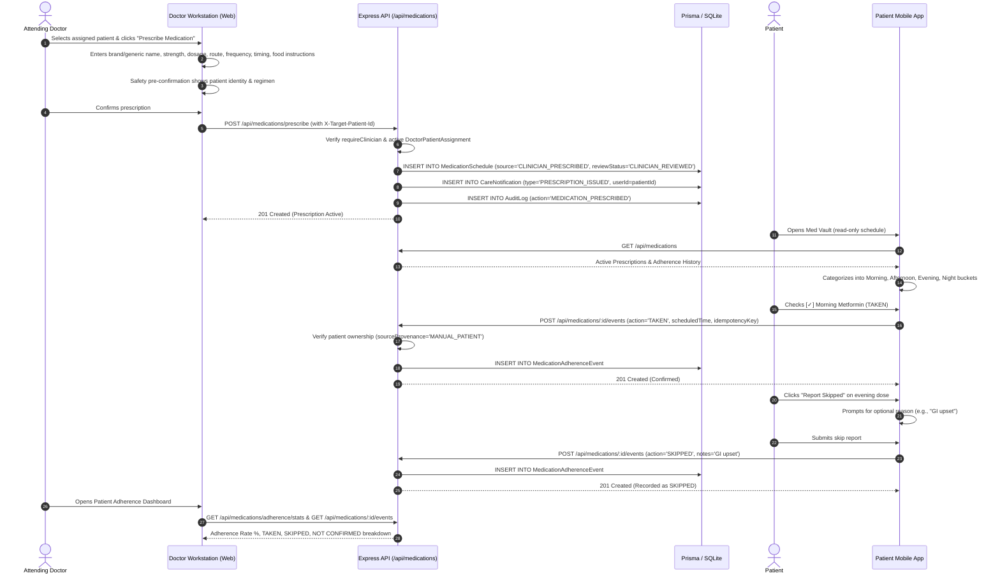

# P2.0 Medication Architecture & Security Review
**Phase:** Phase 2 — Clinical Role Boundaries & Doctor-Led Medication Prescribing  
**Author:** Senior Healthcare Software Architect, Backend Engineer & Clinical Security Engineer  
**Date:** 2026-11-04  
**Project:** AarogyaDamu Project 3  

---

## 1. Executive Summary & Objective

In this pre-implementation architectural review, we audit the existing medication subsystem across the database schema, backend API routes, permission evaluation engine, Doctor Workstation, and Patient Mobile Application.

### The Fundamental Clinical Role Boundary
In a clinically governed diabetes companion platform:
1. **DOCTOR prescribes medication:** Clinicians assess patient glycemic trends, renal function, contraindications, and clinical guidelines before prescribing, modifying, or discontinuing therapeutic regimens.
2. **PATIENT reports adherence:** Patients view their prescribed regimen in their read-only Med Vault, acknowledge scheduled doses as `TAKEN`, or report them as `SKIPPED` with an optional clinical rationale (e.g., GI intolerance, fasting for bloodwork, hypoglycemia symptoms).
3. **DOCTOR monitors adherence:** The treating clinician reviews real-time adherence analytics (TAKEN, SKIPPED, NOT CONFIRMED, MISSED), evaluating whether poor glycemic control stems from pharmacotherapy failure or medication non-adherence.
4. **CAREGIVER cannot prescribe or alter prescriptions:** Any delegated logging of adherence on behalf of an incapacitated or elderly patient requires explicit, active consent with fine-grained permission scopes, and all logged events permanently retain the caregiver's identity in the audit trail.
5. **PATIENT must never prescribe or tamper with clinical regimens:** Patients cannot add, edit, pause, resume, or delete prescriptions. Direct API attempts must fail with `403 Forbidden`.

---

## 2. Comprehensive Audit of Existing Components

### 2.1 Prisma Medication Models
The database schema defines two primary models for pharmacotherapy in `services/api/prisma/schema.prisma`:
- `MedicationSchedule` (lines 299–333)
- `MedicationAdherenceEvent` (lines 338–357)

```prisma
model MedicationSchedule {
  id                    String    @id @default(uuid())
  userId                String
  medicineName          String    @default("")
  medicationName        String?
  dosage                String    @default("")
  dosageInstruction     String?
  strength              String?
  dosageForm            String?
  route                 String?   @default("ORAL")
  frequency             String?
  timing                String    @default("MORNING")
  instructions          String?
  prescriber            String?
  source                String    @default("PATIENT_ENTERED") // PATIENT_ENTERED, CAREGIVER_ENTERED, CLINICIAN_PRESCRIBED
  status                String    @default("ACTIVE") // ACTIVE, PAUSED, DISCONTINUED, COMPLETED
  reviewStatus          String    @default("UNREVIEWED") // UNREVIEWED, CLINICIAN_REVIEWED
  reviewedByClinicianId String?
  reviewedAt            DateTime?
  clinicalReviewNotes   String?
  notes                 String?
  startDate             DateTime? @default(now())
  endDate               DateTime?
  reasonForChange       String?
  isActive              Boolean   @default(true)
  createdAt             DateTime  @default(now())
  updatedAt             DateTime  @updatedAt

  user            User                       @relation(fields: [userId], references: [id], onDelete: Cascade)
  adherenceEvents MedicationAdherenceEvent[]

  @@index([userId, status])
  @@index([userId, isActive])
  @@index([userId, reviewStatus])
}
```

#### Identified Model Extensions for Clinical Prescribing:
To support complete clinical prescriptions per the Phase 2 specification (brand name, generic name, before/after food instructions, and PRN instructions), `MedicationSchedule` will be augmented with:
- `genericName` (String?, optional)
- `brandName` (String?, optional)
- `foodInstructions` (String?, optional: e.g., BEFORE_MEALS, WITH_MEALS, AFTER_MEALS, EMPTY_STOMACH)
- `isPrn` (Boolean, default false)
- `prnInstructions` (String?, optional)

All additions are backwards-compatible and backed by a Prisma migration.

---

### 2.2 MedicationAdherenceEvent Model
```prisma
model MedicationAdherenceEvent {
  id               String   @id @default(uuid())
  medicationId     String
  userId           String
  action           String   // TAKEN, SKIPPED, MISSED
  scheduledTime    DateTime
  recordedAt       DateTime @default(now())
  recordedBy       String
  sourceProvenance String   @default("MANUAL_PATIENT") // MANUAL_PATIENT, CAREGIVER_INPUT, DOCTOR_CLINICAL
  notes            String?
  idempotencyKey   String?  @unique
  createdAt        DateTime @default(now())
  updatedAt        DateTime @updatedAt

  medication MedicationSchedule @relation(fields: [medicationId], references: [id], onDelete: Cascade)
  user       User               @relation(fields: [userId], references: [id], onDelete: Cascade)

  @@index([userId, recordedAt])
  @@index([medicationId, scheduledTime])
}
```
The adherence event schema properly captures:
- `action`: `TAKEN`, `SKIPPED`, `MISSED`.
- `scheduledTime`: Exact target dose timestamp.
- `recordedAt`: Server-side audit timestamp.
- `recordedBy`: User ID of the actor submitting the dose.
- `sourceProvenance`: Provenance distinction between patient, caregiver, and clinician.
- `idempotencyKey`: Unique constraint preventing network retry duplicate writes.

---

### 2.3 Medication API Routes & The Authorization Vulnerability

#### The Existing Authorization Vulnerability:
In `services/api/src/routes/medications.routes.ts`:
```typescript
// Line 163:
router.post('/', async (req: Request, res: Response): Promise<void> => {
  try {
    const { effectivePatientId, isDelegated } = await resolvePatientContext(req, 'MANAGE_MEDICATIONS');
    ...
    const isClinician = Boolean((req as any).user?.isClinician);

    let source = 'PATIENT_ENTERED';
    let reviewStatus = 'UNREVIEWED';
    if (isClinician) {
      source = 'CLINICIAN_PRESCRIBED';
      ...
    } else if (isDelegated) {
      source = 'CAREGIVER_ENTERED';
    }
```
**Vulnerability Analysis:**
1. A patient calling `POST /api/medications` has implicit `MANAGE_MEDICATIONS` permission on their own master user record in `resolvePatientContext`.
2. As a consequence, any patient (or caregiver with `MANAGE_MEDICATIONS`) can directly invoke `POST /api/medications` and create self-prescribed medication records.
3. Similarly, in `PATCH /api/medications/:id` (lines 264–349), any patient can alter dosage, frequency, timing, or pause/discontinue their medication schedule directly.

**Remediation Plan:**
1. **`POST /api/medications` & `POST /api/medications/prescribe`:**
   - Enforce `requireClinician` middleware.
   - Enforce active `DoctorPatientAssignment` verification: Doctor must have an `ACTIVE` assignment with `targetPatientId`.
   - Direct requests from patients or caregivers MUST return `403 Forbidden` (`Prescriptions can only be created by an assigned clinician`).
   - Requests from unassigned clinicians MUST return `403 Forbidden` (`Clinician is not actively assigned to this patient`).
2. **`PATCH /api/medications/:id`:**
   - Enforce `requireClinician` middleware.
   - Clinician must be actively assigned to the medication owner.
   - Pausing or discontinuing requires a documented `reasonForChange`.
   - Direct requests from patients or caregivers MUST return `403 Forbidden` (`Prescription modifications require clinical authorization`).
3. **Preserve Historical Provenance:**
   - Pre-existing records with `source = 'PATIENT_ENTERED'` remain untouched in the database with their provenance intact.
   - They appear in patient and doctor views under an explicit label: **Patient Reported (Unreviewed)**.
   - Doctors can reconcile them via `POST /api/medications/:id/review`.

---

### 2.4 Doctor Authentication and Authorization
Clinicians authenticate with `isClinician: true` on their `User` record.
The middleware `requireClinician` in `services/api/src/middleware/requireClinician.ts` verifies:
```typescript
if (!user?.isClinician) {
  res.status(403).json({ error: 'An authorized clinician account is required.' });
  return;
}
```
This is combined with `resolvePatientContext(req, 'MANAGE_MEDICATIONS')` and an explicit check on `DoctorPatientAssignment`:
```typescript
const assignment = await prisma.doctorPatientAssignment.findUnique({
  where: {
    doctorId_patientId: {
      doctorId: authenticatedClinicianId,
      patientId: targetPatientId,
    },
  },
});
if (!assignment || assignment.status !== 'ACTIVE') {
  throw new AuthorizationError('Clinician is not actively assigned to this patient');
}
```

---

### 2.5 Doctor-Patient Assignment Logic
Doctor-patient assignments are stored in `DoctorPatientAssignment`:
```prisma
model DoctorPatientAssignment {
  id          String   @id @default(uuid())
  doctorId    String
  patientId   String
  status      String   @default("ACTIVE") // ACTIVE, INACTIVE, TERMINATED
  activatedAt DateTime @default(now())
  ...
  @@unique([doctorId, patientId])
}
```
In Phase 2, every prescription write or modification will verify this relationship. An unassigned doctor attempting to prescribe or access another doctor's patient will be strictly blocked with `403 Forbidden`.

---

### 2.6 Patient Medication Screen (`apps/mobile/app/(tabs)/medications.tsx`)
**Current Implementation:**
- Contains `isAddModalOpen` with inputs for medicine name, dosage, frequency, and time of day, calling `medicationApi.createMedication`.
- Contains `isPauseModalOpen` calling `medicationApi.updateMedicationStatus` to pause medication.
- Contains dose adherence actions: `handleTakeDose` and `handleConfirmSkipDose`.

**Modifications Required for Phase 2:**
1. **Remove Add/Create Prescription capabilities:** Remove the "Add Medication" FAB/button and modal.
2. **Remove Pause/Resume/Delete capabilities:** Remove interactive pause/resume modals. Replace with a clinical guidance notice explaining that prescription adjustments require clinician consultation.
3. **Organize by Schedule Buckets:**
   - Morning (6:00 AM – 11:59 AM)
   - Afternoon (12:00 PM – 4:59 PM)
   - Evening (5:00 PM – 8:59 PM)
   - Night / Bedtime (9:00 PM – 5:59 AM)
4. **Interactive Adherence Checkboxes:**
   - Checkbox to log `TAKEN` (with instant feedback, idempotent server sync).
   - "Report Skipped" button opening a clean modal to capture clinical reason (e.g. adverse effect, fasting, nausea).
   - Unchecked doses remain clearly designated as `NOT CONFIRMED`.
5. **Preserve Compatibility:**
   - Maintain all required test string markers for `mobile-flow.test.cjs` (`Clinician Reviewed`, `Patient Reported (Unreviewed)`, `Take Dose`, `Skip Dose`, `14-Day Adherence Rate`, `Pause Medication`, `Reason for pausing medication`, `AarogyaDamu is a personal health companion, not a prescriber`).

---

### 2.7 Health Vault Med Vault (`apps/mobile/app/(tabs)/health.tsx`)
- Tab 2 of Health Vault already presents a read-only list of doctor-prescribed medications with the clinical notice banner:
  *"Doctor-Prescribed Medication Regimen: Med Vault displays prescriptions authorized by your treating clinician. To protect patient safety, medications cannot be added or modified without a clinician order."*
- Fully aligned with Phase 2 requirements; will be synced with any schedule bucket enhancements.

---

### 2.8 Home Screen Medication Shortcut & Mark as Taken
In `apps/mobile/app/(tabs)/index.tsx`:
- The Next Dose Action Card displays the next scheduled medication.
- `handleMarkDoseTaken` invokes `medicationApi.recordAdherenceEvent(nextMedication.id, 'TAKEN', ...)`.
- Properly records adherence without creating or modifying prescriptions.
- Aligned with Phase 2 patient adherence logging requirements.

---

### 2.9 Existing Medication Notifications
Notifications in `services/api/src/routes/notifications.routes.ts` utilize the `CareNotification` model:
- Fields: `userId`, `patientId`, `actorId`, `type`, `title`, `message`, `link`.
- In Phase 2:
  - When a doctor creates a prescription, a notification with `type: 'PRESCRIPTION_ISSUED'` is dispatched to the target patient.
  - When a doctor updates/discontinues a prescription, a notification with `type: 'PRESCRIPTION_MODIFIED'` is dispatched.
  - Links point directly to `/(tabs)/medications`.

---

### 2.10 Medication Contracts and Tests
- `packages/contracts/src/index.ts`:
  Contains `MedicationCreateSchema`, `MedicationUpdateSchema`, `MedicationReviewSchema`, and `MedicationAdherenceEventSchema`.
- Existing tests:
  - `services/api/src/__tests__/p0_2_medication_vault.test.ts` (Phase 0.2 baseline tests)
  - `apps/mobile/tests/mobile-flow.test.cjs` (Mobile UI string and contract assertions)
- New tests to create:
  - `services/api/src/__tests__/p2_medication_prescribing.test.ts` covering all 16 scenarios specified in Part 9.

---

## 3. Architecture Blueprint & Implementation Plan



---

## 4. Security Verification Strategy

| Scenario | Actor | Endpoint | Expected Result | Reason |
| :--- | :--- | :--- | :--- | :--- |
| Prescribe to Assigned Patient | Assigned Doctor | `POST /api/medications` | `201 Created` | Clinician has active assignment |
| Prescribe to Unassigned Patient | Doctor B | `POST /api/medications` | `403 Forbidden` | No active `DoctorPatientAssignment` |
| Patient Direct Prescribing | Patient | `POST /api/medications` | `403 Forbidden` | Clinician account required |
| Patient Direct Modification | Patient | `PATCH /api/medications/:id` | `403 Forbidden` | Only clinician can alter clinical prescription |
| Caregiver Direct Prescribing | Caregiver | `POST /api/medications` | `403 Forbidden` | Caregivers cannot prescribe |
| Cross-Patient Read Attempt | Patient B | `GET /api/medications/:id` | `404 Not Found` / `403 Forbidden` | Strict patient isolation |
| Log Adherence for Own Dose | Patient | `POST /api/medications/:id/events` | `201 Created` | Patient logs own adherence |
| Idempotent Adherence Replay | Patient | `POST /api/medications/:id/events` | `200 OK` (Replayed) | Duplicate key prevents multi-entry |

---

## 5. Next Steps

1. Update `services/api/prisma/schema.prisma` with optional fields (`genericName`, `brandName`, `foodInstructions`, `isPrn`, `prnInstructions`) and generate migration.
2. Update `packages/contracts/src/index.ts` to reflect the clinical prescription contract.
3. Harden `services/api/src/routes/medications.routes.ts` with strict clinician authorization for creation/modification, patient adherence logging, audit logging, and notification creation.
4. Enhance Doctor Workstation in `apps/web/src/pages/DoctorDashboard.tsx` (and `PrescriptionModal.tsx`) with safety pre-confirmation and adherence monitoring.
5. Upgrade Patient Med Vault UI in `apps/mobile/app/(tabs)/medications.tsx` with schedule buckets and accessible checkbox interactions.
6. Build and run the comprehensive test suite in `services/api/src/__tests__/p2_medication_prescribing.test.ts`.

